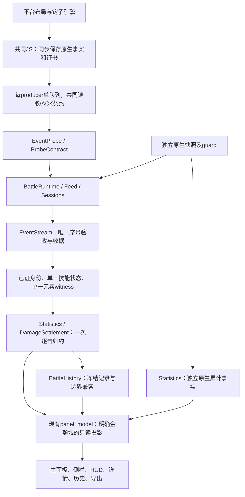

# 从采集钩子到展示的重构规划

状态：规划稿，尚未实施。基线：`667bb2e320c76ad60f64b02a5a5e6a4a4b6b2b86`，2026-11-25。范围为当前产品、无界面采集、回放及它们实际调用的一方代码。本文不改变伤害口径、平台支持或既有历史文件。

## 判断与完成目标

当前存在活跃的同功能并行实现：同一技能事件更新两套状态，旧伤害派生账本与逐击账本同时运行，部分结果在发布末段被覆盖；元素来源、终局决策及展示投影也有重复维护。它们已经使修复需要跨多处同步，且容易产生口径、未知状态和生命周期不一致。

三端并不是三套结算算法：Android/MuMu、PC Frida、PC ArkPie已经通过`assemble_probe_source`共享`event_probe_autochess.js`及`event_probe_runtime.js`。本次应收敛共享实现内部和上下游的重复职责，继续保留必要的平台布局、钩子引擎及独立验证。

重构完成必须同时满足：

1. 每种逐击金额、技能效果状态、元素来源和展示口径只有一个运行时写入者；旧路径不再先计算后覆盖。
2. 每个原始事件有唯一的传输级验收收据，必要消费者完成后只向producer确认一次；各玩家及共享world仍保留自己的处理位置、skip记录与foreign隔离。一笔事件可以投影多个指标，但不再驱动两套同事实可变账本。
3. 真实零帧、新小局状态、上一小局回看副本分离；回看绝不作为下一局的初态。
4. 旧schema只在读取边界解释；当前产品没有永久双写、后台影子计算或静默fallback。
5. 逐阶段删掉已迁移状态、分支、冗余wire及无生产调用的旧实现；仅把函数搬到新文件不算完成。
6. 保留缺证、未知、断流、归属冲突和未完成收尾；不能以数值补零或说明文本代替修复。

## 审计范围与证据

源码清单、SHA、Python静态import及精确AST函数体重复候选保存在`runtime/refactor-plan-20261125/source-inventory.json`。共索引111份一方源码候选、52,908行：68 Python、33 C#、5 JS、4 C++、1头文件。候选包含诊断/构建辅助入口，不等于111份都处于游戏热路径。打包入口`tools/package_windows.py:48`另外声明40个根级backend载荷。

人工审计按真实入口追踪，详见同目录的collection/statistics/presentation审计附件及`audit-receipts.json`。附件的备选方案不自动进入实施范围；合并后的取舍以本文为准。静态import不能证明动态RPC字段无人消费；没有调用的声明也不能替代包内验证。`vendor/`数据、第三方库、生成文件、运行包副本及`archive/legacy-tk/`不计为活跃业务双实现。原生`hooks.S`和WPF XAML绑定沿实际C++/C#入口另外追踪，不在上述五种扩展名计数中。原始录制和旧战绩保持不变。

性能基线另见`runtime/test12-current-r11-20261125/diagnosis.md`：测12当前R11存在连续32秒2–7 FPS，保存HP变化全为下降。它支持调查普通扣血/结算热点，尚未量化各钩子的实机耗时；不能把所有技术债都宣布为本次掉帧原因。

## 现有控制面与不变量

沿用`AGENTS.md`、`docs/desktop-runtime.md`、`docs/event-probe-interface.md`、`docs/statistics-core.md`和既有ADR，不另建治理框架。WPF负责展示，Python负责采集编排、统计及历史，共同JS同步保存原生事实。

| 不变量 | 执行保护及当前边界 |
| --- | --- |
| 原生累计总伤害含过量；事件不能再加一次；source-null元素仅补客户端未计部分 | ADR0001/0004/0006；`test_stats_core`、元素/settlement/adapter专项；跨新旧lane全字段差分仍需补齐 |
| 原生累计、观察期名义结算、有效HP/盾分别保留来源、窗口与完整性 | `test_settlement*`、`test_snapshot_adapter`、`test_panel_model`；能力选择和旧schema全部组合需补齐 |
| 同一CID不同账号、data UID、native实例、出生周期不能混为一体 | native actor/token/form、multiplayer isolation、deployment专项；统一resolver后的同局组合仍需验 |
| 原始序号有序且幂等，消费成功后ACK；ACK失败不能重算或误封口 | probe contract、event stream、retry、terminal专项；跨入口提交路径需收敛 |
| 零帧来自真实reset返回及完整开局前缀，不能从后来采样或旧局累计伪造 | round-start、retained-queue、scope handoff专项 |
| 局部坏命中只影响对应actor/金额分量；真正断流使该区间覆盖失效 | local settlement、quality isolation、business frozen fixtures；合并账本后仍须分量验证 |
| 技能施放返回、效果结束、暂离、死亡、body结束、对局结束是不同事实 | skill cast/ammo、deployment、lifecycle专项；当前双FSM正是待消除项 |
| 游戏时钟决定DPS/HPS，暂停不推进；伤害/治疗各自1.5秒接敌区间；未知分母不补零 | ADR0002、stats/settlement/panel专项 |
| 回看副本不可变且不进入新局；历史读取不重写原档 | history、retention、native defense/assist projection专项 |
| 退役观察器清理失败仍保留所有权；后端失败不静默换后端 | session、observer、native startup/cleanup专项 |
| 各端实际提交同份共同JS；包内源码、二进制和worker协议匹配 | probe parity/source、native package、WPF contract及Windows CI |

以上为已有机制及已识别缺口，不代表本轮执行过这些测试。逐项命令与新增门禁见后文。

## 从钩子开始的实际调用链

1. `PcEventSource`选择PC Frida/ArkPie启动owner；MuMu通过既有ADB/Frida准备。`CollectionSession`拥有附加后的observer及采集资源。平台collector另外读取独立累计、编队、时钟与guard。
2. `assemble_probe_source`组合context、平台adapter、共同runtime。`Entity.ApplyModifier`、目标受击、输出、HP setter、盾、元素条、技能及body生命周期回调共同产生证据。回调方法是证据输入，不等于最终发送的事件种类。
3. 共同JS维护在途调用、父子结算、HP前后、来源/目标、技能原生状态与scope，向有界队列写记录。HP连续尾合并只压缩合法的未发布记录。`mark/readEvents/ackEvents`按前缀读取与确认；不是每笔回调直接`send()`。
4. `FridaEventObserver`或`NativeHookEventProbe`等传输适配实现`EventProbe`。`ProbeContract`验证后端绑定、批次、质量、重放和ACK范围。
5. `BattleRuntime.poll → BattleFeed.acquire`取得独立snapshot和前后mark。`BattleSessions`建立局实例、选择开局/阶段/终局证据。`LiveEventCapture.ingest`交给单局或卫戍各玩家的`EventStream`。
6. `EventStream.accept`验证顺序并分发。当前`damage_settlement → Statistics.record_damage_settlement → DamageSettlement.hit`；`damage/hp_damage/elemental_burst → Statistics.event`仍维护旧派生路径；skill事件先写owner窗口，再写actor窗口。
7. `Statistics.result`、adapter、multiplayer投影汇合结果。当前v7在`stats_core.py:2153`之后又覆盖部分此前计算的effective/overkill字段。
8. `CollectionSession`交付发布样本并经`BattleHistory`归档；`DesktopState`、`panel_model`、`battle_share`生成实时/历史/导出投影，stdio交WPF呈现。

## 目标调用链



`DamageSettlement`仍按名义、实际HP、实际打盾、过量、公式配对分别保存证据；单次归约不等于合成一个总数。boss是目标子集投影；不同账号、actor和部署周期仍分区。WPF不新增统计器。

图中的身份/技能/元素节点按原始事件kind执行对应转移，不表示所有事件先改一遍技能和元素。burst只能读取并消费此前同生命周期的bar，不能提前使用后续事件的见证。分区consumer保留必要游标和局部质量；不对同一前缀逐玩家分别发送ACK。

## 同功能实现清单与处置

下列为已确认重复、被覆盖计算及可移除候选。行号均对应冻结基线，实施前再次核对。每项收敛均须迁完消费者后删除原存储/分支，不能仅留一个“统一接口”包装原来的两套状态。

| 编号 | 当前同功能实现及证据 | 唯一归属与具体处置 | 删除前提 |
| --- | --- | --- | --- |
| D01 | `FridaEventObserver.commit_events:230`与`NativeHookEventProbe.commit_events:902`分别维护committed/acknowledged/ack_error | 在现有`event_probe.py`共用游标转移和确认结果；传输仍各自实现 | ACK绑定原observer/stream寿命；另一次mark不能替跨reset整数ACK认证；丢ACK、重复/超read ACK、晚回复向量一致；InternalEventProbe的锁与严格回复不削弱 |
| D02 | 两个PC runtime分别维护start/retry/cancel/_commit、watcher及cleanup_pending | `PcEventSource`保持启动owner；提纯共同取消、进程出生候选和清理转移 | Gadget token/lease/auth与ArkPie prepared claim/expiry/once-per-process分别保持 |
| D03 | 多个probe分别实现mark/read/range/terminal/release协议包装 | `EventProbe/ProbeContract`共用参数、范围和回复判定；adapter保留I/O和清理动作 | pipe、Frida、subprocess超时/取消/拒绝/退出语义全部保真；不引入万能transport基类 |
| D04 | `EventStream:301–328`先写`skill_active`，再写`settlement_skill_active`；同一个转换函数对应两套存储 | `Statistics`内唯一按scope/账号/actor/deployment分区的技能效果FSM；owner只聚合 | cast返回与effect结束、死亡两顺序、暂移11/12、同名及换body全部通过；删除双窗匹配要求 |
| D05 | `skill_incomplete/skill_unknown`与actor/deployment技能质量重复维护 | 同一FSM输出当前状态及历史区间质量 | 后续恢复不洗掉历史未知；明确陌生UID只污染对应实例，不扩散为全员未知 |
| D06 | `settlement_bars:528–573`与`last_elemental/burst:1605–1684`维护两份最后元素来源 | `Statistics`内唯一target UID+native instance+出生周期+scope witness | foreign、gap、重生清理一致；Born-return后延迟entry不误清；只消费一次 |
| D07 | `settlement_supplements:645–649`与`burst.added_settlement:1656–1671`分别维护原生累计外补充 | 唯一归属结果生成一次补充事实，再只读投影 | source-null与显式source区分；显式source不重复补累计；未知归属仍保未分配量 |
| D08 | `Statistics.event:1699–1766`旧伤害路径与`record_damage_settlement:575`并行归约 | `DamageSettlement`成为逐击金额唯一聚合；`Statistics`编排身份和分类 | 旧source、engagement、skill、quality消费者逐项迁走；原生累计仍独立 |
| D09 | `result:2079–2082`等先算旧effective/overkill，`2157–2167`又覆盖 | 根据已选能力/金额域一次构造结果 | 保留pre-observer、scope mismatch和逐分量完整性门禁；删覆盖前无效计算 |
| D10 | `PartialDamage:70`与settled重叠保存观察部分及近期量 | 从单一逐击聚合只读投影partial字段 | 每字段来源/窗口/质量等价后删`PartialDamage`存储；不把观察量升级成完整量 |
| D11 | `BossDamage:135`与`settled_boss:657–662`两路维护boss金额 | 同一hit分类一次，boss是聚合子集 | boss未知分类保留；迁完消费者后删旧`BossDamage`归约 |
| D12 | legacy engagement、PartialDamage、BossDamage、DamageSettlement重复维护1.5秒区间合并算法 | 在统计层共用纯区间合并操作 | 名义/有效/治疗保留各自触发集合；不共用一个active布尔或分母 |
| D13 | `hp_damage`、legacy `damage/elemental_burst`与settlement带重叠事实；`hp_damage`仍作来源对账 | 完整结算证书承载其必要来源/诊断事实；最后按当前能力停发冗余记录 | D04–D12完成；原生回调输入不能随wire删除；旧输入不伪造完整证书 |
| D14 | settlement启用时`EventStream:296–300`跳过旧enemy_damage，另由settlement更新 | 世界目标事实只由唯一已验收hit更新一次 | 多玩家世界副本不可相加；旧schema仍可按能力读取 |
| D15 | adapter、multiplayer分别编排CID/UID/token/form解析（`snapshot_adapter:537`、`multiplayer_battle:704/792`） | 复用`autochess_context`既有归一/解析函数 | counter key与账号actor是不同身份类型；无CID/名称猜测fallback |
| D16 | Feed、Sessions、adapter、Stats、MP及CollectionSession旧分支都有收尾判断/补救 | `BattleSessions`选择终端证据与终点；`BattleRuntime`编排提交；各归约器仅执行明确finish | 首尾证据、尾笔ACK、阶段先变/clock后归零、退出/断连反例通过 |
| D17 | `CollectionSession.read:353–386`非runtime旧路径与生命周期路径并存 | 产品采集统一走既有`BattleRuntime` | 清点CLI/QA调用后迁移；snapshot-only仍是有名能力模式，不能冒充完整事件 |
| D18 | `capture_battles.capture:24`独立旧快照循环与`capture_cli.run_capture`生产执行重复 | 旧命令委托现有CollectionSession/采集执行，保留journal adapter | 原证据格式及`replay_product`继续可读；不能整模块删除 |
| D19 | `PanelSourceRow`、`live_damage_rates:918`、boss rates、`detail_rates:1122`分别选金额/窗口/完整性 | `panel_model`一次提供有名字的指标读数，榜单/详情/趋势共同读取 | 不同口径保留不同读数；禁止从排好序的榜单反推全队或趋势 |
| D20 | WPF `Inspector.OverkillReading:915`、`SkillSplitReading:960`、`MitigationReading:996`重选证据并算比例 | Python提供数值、分子分母、窗口、质量及原因；WPF只渲染 | 跨语言同份边界golden；迁完客户端后删C#业务计算与旧payload fallback |
| D21 | 本家/四家、多配置每poll反复`rows_from_statistics/_actor_view` | 同一发布revision、相同scope规范化一次；不同配置只做必要投影 | revision覆盖同帧修订、序号、质量、玩家、目标、口径及配置；只缓存稳定view内容，采样/IPC/FPS年龄每次按原时间计算；保线程/调用方隔离 |
| D22 | `PanelEntry.detail`与`details_by_owner`重复详情（`panel_model:1665/1691`） | UI DTO只保留一份按owner索引详情 | 先迁`RowItem:79/119`、Inspector fallback，再删wire字段；归档证据不裁剪 |
| D23 | `view.source`原始树与detail/settled树多次携带 | DTO只携实际展示所需字段 | 列完Inspector原始对账/身份/在场依赖；导出原证据仍完整 |
| D24 | 旧schema修补散落在reader、`battle_share`及展示字段选择 | `BattleRecord`读取边界解释旧版本；进入展示前统一规范化 | 保留原字段存在性；原档不改写，缺字段未知；raw replay比较原输入而非补齐对象；历史字节SHA及对外独立对象保持 |
| D25 | `metrics.Meter:13`另算累计DPS、近期DPS、share，但生产仅导入`observation_age` | 删除无产品调用的Meter类；保留年龄函数 | 重查所有入口和打包；将年龄测试与无生产对象的旧算法测试分离 |
| D26 | `battle_share.record_view:207`、`panel_model.render_board:1718`等旧组合wrapper | 退为调用现有view的窄兼容入口，或无活动调用时删除 | 检查动态工具入口；封存Tk不修改、不恢复、不反向导入 |

### 应共享规则、仍需保留的不同实现

| 看起来相似的路径 | 保留理由及允许收敛部分 |
| --- | --- |
| ArkPie/Frida钩子引擎；Android/PC adapter | 不同ABI、内存布局、加载与I/O；共享领域JS、能力/错误语义，不复制领域公式 |
| producer现场guard与collector外读guard | 独立证据交叉约束，不能拿producer返回值自证；可共享布局描述，不缓存现场动态值 |
| ApplyModifier、Unit.OnTakeDamage、OnAfterOutputDamage | 同一命中不同阶段见证；关闭冗余输出不等于删除输入hook |
| 三类HP写入口及MaxHP属性回调 | 普通写、直接写和属性变化覆盖不同场景；无充分证据现在删任何已启用hook |
| shield_absorbed与逐击打盾量 | 施盾者吸收贡献与攻击者打盾输出不同角色，不合成一个shield total |
| 原生累计、逐击nominal、逐击effective | 不同来源/区间/完整性；不能互补缺证或自动相加 |
| body生命周期、采样presence、接敌区间 | 完整在场、观察下界及输出活跃区间不同；不以max或fallback暗中改口径 |
| 主面板、侧栏、HUD排行 | 已共享Python view和StatisticPanel；保留各自交互/布局，避免再重写一遍 |
| 完整详情固定接敌速率与侧栏当前所选速率 | 名字和口径不同；共享对应读数而非强制同值 |
| 实时与历史页面 | 已共用DesktopState.view/render_panel；旧档解码和冻结选择是合理边界 |
| 采样过期、IPC响应过期、FPS过期 | 不同失效来源；共享原因/时钟测试，保留三个可追溯状态 |
| worker数据poll、侧栏几何timer、设置防抖、独立FPS线程 | 不同职责；不能按timer数量删除 |
| 文件字节验证、跨线程副本、JsonElement.Clone、原始重放比较 | 信任与所有权边界；只优化已证明重复的内部转换 |
| cooperative writer/reader/host校验 | 输入、传输和接收有不同信任边界；只共享共同格式校验，不互相替代 |
| `autochess_context._time`与`event_probe._round_start_time`等小validator | 精确AST重复不是架构收益证明；优先合并领域状态，避免新增跨层utils依赖 |
| FPS的DXGI与Android SurfaceFlinger实现 | 真实数据源和时钟不同；既有GameFpsMonitor拥有共同生命周期 |
| 发布包源码/manifest在Python与C#分别校验 | 两进程分别保护实际加载边界；共同包清单是事实来源，不取消独立验证 |

## 隐式状态机与唯一归属

下表是要显式固定的转移，不要求为每行新增类或框架。

| 状态机 | 转移及reset边界 | 唯一归属与合并要求 |
| --- | --- | --- |
| PC启动 | 未准备→准备→精确进程出生ready→失效/取消→待清理→已释放 | PcEventSource拥有runtime；共用通用转移，adapter执行不同准备/释放 |
| observer资源 | 未附加→等待初始化→ready→retired待释放→可重建 | CollectionSession；清理失败不丢owner、不创建第二份观察器 |
| 请求 | 已发ID→单inflight→匹配回复/拒绝/超时→晚回复失效 | 每transport拥有I/O；共同结果和游标规则，不跨generation接回复 |
| 原生回调 | entry→父子/同线程/并发关联→leave→静默 | 共同runtime；active/epoch和native VM锁耗时是不同指标 |
| 事件队列 | 每producer：未发布尾→固定序号→读前缀→宿主消费→ACK释放 | 共同契约不强合容器：实时JS未ACK队列与cooperative host容量/已ACK重放策略不同；溢出明确失败，不覆盖未ACK数据 |
| 单局接收提交 | 真实baseline→有界读取→验证→幂等消费；普通发布与ACK各有提交状态，终局需尾确认才封口 | BattleRuntime编排；ACK绑定原observer/stream；丢ACK保留收据重试确认、不再次归约，也不无条件阻塞已接收普通样本发布 |
| 小局世代 | 真实reset零帧→完整开局前缀→active→阶段/终局交接→retired | Feed提供原始证据，Sessions建局；阶段先变而clock未归零不可污染新初态 |
| 账号/来源 | 已证→暂缺→同scope恢复，或foreign/token/unknown/conflict | autochess_context解析，adapter/MP选择当前scope；禁止姓名猜归属 |
| 原生累计 | 未基线→单调快照→缺口/新基线→可靠终点 | Statistics独立累计事实；不从事件回填丢失区间 |
| 逐击结算 | source/target/clock→目标阶段→父子HP/盾检查点→complete/partial | 共同JS出证，EventStream验收，DamageSettlement一次聚合；分量独立未知 |
| 技能效果 | initial unknown/inactive→cast→effect active→cast返回但效果仍active→真实effect end | 单actor/deployment FSM；无active的真实end仍可证后续inactive；历史未知不回填 |
| 技能终端事务 | OWNER_DEAD与CharacterFinished可两顺序到达→同clock确认；暂移独立 | 同FSM与DeploymentLifecycle各接自己的事实；断连/安静不当技能结束证明 |
| body在场 | 已证零帧活体/真实Born→open→真实Finish | DeploymentLifecycle；新body不继承旧技能或时长；body活体不证明技能初态 |
| 元素 | bar见证→更新/foreign/unknown→burst一次消费→出生周期结束清理 | 单target witness；Born-enter、Born-return、首次入图admission分别处理 |
| 敌人生命/阶段 | entry→HP/MaxHP变化→假死/重生/finish→新周期 | 现有enemy telemetry/事实存储清晰分工；回血不等于负伤害 |
| 展示回看 | 当前scope→旧局冻结→准备回看→新scope首可靠样本替换 | DesktopState；回看不能驱动采集器和新局初态 |
| 数据新鲜度 | 原采样年龄live/paused/stale；IPC超时；FPS窗口过期分别推进 | 各原owner；入队/出队/重渲染不更新采样时间 |
| 发布/趋势 | 新revision→全部接收点维护峰值→scope/gap切段→同秒显示桶 | DesktopState；计算投影可共享，不能丢FIFO中间sample而丢峰值 |
| 战绩提交 | pending→验证→临时文件/fsync/原子替换→读回→保留扫描→通知 | CollectionSession/BattleHistory；失败保留待写，提交成功才通知 |
| UI选择/worker | hello→串行请求/replay→退出清理；live pin/history selection各自寿命 | 既有BridgeClient/DesktopState；DTO收敛不抹掉用户选择和请求幂等 |

## 分阶段实施与删除门禁

| 阶段 | 工作及范围 | 必须交付的删除/收敛结果 | 依赖与验收 |
| --- | --- | --- | --- |
| R0 冻结合同和基线 | 逐字段列出native/nominal/effective来源、窗口、质量及所有消费者；固定原始fixture和R11证据；记录各层成本 | 不加业务框架；形成可差分输入及明确field映射 | 所有后续阶段前置；失败样本保留，不因新实现通过重写旧输入 |
| R1 唯一身份与技能状态 | D04/D05/D15；精确actor/deployment，统一初态、施放、效果、死亡/退场 | 删除第二份skill状态及双窗匹配；owner时间为只读聚合 | R0；零帧、缺初态、同名、旧body晚回调、死亡两顺序、真end无active等反例 |
| R2 唯一元素witness | D06/D07；一次归属、一次消费、一次累计外补充 | 删除第二份bar缓存/补充写入路径 | R0；可与R1分工但合并时复核shared Statistics；元素嵌套/延迟entry/foreign/reborn |
| R3 唯一逐击归约 | D08–D12/D14；逐指标迁移partial/boss/overkill/skill/engagement | 删除被覆盖计算和旧派生存储；结果构造只选一次金额域 | R1/R2；每字段正例、未知和完整零对账；native累计不等于观察量的反例 |
| R4 精简输出并优化钩子热点 | D13；先迁来源诊断/legacy副作用，再按能力停发冗余wire；分测native包装、锁、JS读及队列 | 当前版本不再为同事实发旧+新记录；清理无用构造 | R3；raw证书保真/序号单调/重放幂等；保留必要输入hook；性能变更须独立计时 |
| R5 唯一采集提交与终局决策 | D16/D17；集中baseline、阶段、终局、ACK、归档交接 | 删除CollectionSession独立旧finish决策；Feed/Sessions/Runtime各一职责 | R0可独立推进；首笔/末笔、阶段先变/clock后reset、ACK失败、空片段、断连退出 |
| R6 唯一指标读数与精简展示DTO | D19–D24；指标选择归Python，按revision共享；迁WPF再删重复详情/原始树 | 删除C#业务比例/证据选择、重复wire及多次相同规范化 | R0先定读数；R3结果稳定后切换；榜单/侧栏/HUD/详情/历史/导出同口径一致 |
| R7 共用宿主协议及采集执行 | D01–D03/D18；ACK规则、清理结果、PC通用转移、CLI/诊断委托 | 删除协议控制副本和旧独立采集循环；各adapter只留差异 | R0；与R5按文件所有权顺序合并，不能同时改加载协议、DLL与UI重连 |
| R8 删除余留与交付 | D25/D26；移除无消费者状态/字段/入口/包载荷，修订契约及文档 | 当前路径无legacy双写/最后覆盖/隐式fallback；旧档只在边界读 | 前述阶段；完整回归、原生自有进程、WPF无输入检查、包清单、隔离CI与实机分层验收 |

推荐首批并行：R1身份/技能、R5采集终局、R6指标读数合同，由root整合R0及重复清单。R2/R3共同修改统计核心时按提交依赖串行合并；R4必须等消费者迁完，不能抢先“关hook”。每批有明确提交、前后证据和回滚点，避免一个大PR同时改变采集事实、公式和展示。

迁移期间只在离线差分工具运行旧/新对照。当前产品每项指标仍只选择一个写入者，不部署长期shadow双写。回滚使用前一个完整匹配包，不通过运行时悄悄切回旧金额路径。

### 与近期故障的对应

| 故障 | 结构性修复阶段 | 预期结果与界限 |
| --- | --- | --- |
| 个别干员技能初态、死亡后技能未结束、同名/旧body污染 | R1+R5 | 单实例状态与真实零帧；死亡/退场/终局证据各司其职，不靠额外文案消除未知 |
| 星号、source-null元素、嵌套拒收 | R2+R3+R4 | 唯一元素来源和逐击账本；真实缺检查点仍拒收，并另修producer证据路径，不能仅合并后标complete |
| 治疗/全周期DPS在不同界面不一致 | R1+R3+R6 | 同口径共享数值与分母；观察治疗不伪装原生累计，缺完整在场仍未知 |
| 0/xx错误提示、局部缺证污染全员 | R1+R3+R6 | 未核实数为零不产生该项错误；真正断流/缺覆盖仍单独保留；不隐藏质量失败 |
| 后期延迟/数据过期但不掉帧 | R5+R6+R7 | 削减重复物化与协议编排，年龄仍基于原采样时刻；不提高过期阈值掩盖延迟 |
| 测12 R11严重掉帧 | R4及R0分层计时 | 优先减少重复采集/输出与已证热点；是否解决实机掉帧须同条件验证，不能由删代码或离线速度推定 |
| 归档最终水位、阶段空片段、跨小局保留污染 | R5 | 单一提交/终局决策和只读回看；旧局保留不参与新局建立 |

## 指标读数和兼容边界

沿用既有`PanelSourceRow/PanelView`，扩充必要读数字段，不新建第二统计核心或通用metric注册系统。一份读数至少包含数值/单位、名义或有效、目标/玩家scope、时间窗口、分母来源、完整或已观察、不可用原因。细节比例使用同一分子分母，WPF不再自行在完整/已观察字段间选择。

当前完整详情的固定接敌速率与侧栏所选recent/engagement/full-cycle是两个有名字的读数；统一算法及证据选择，保留各自定义。`unknown→0`不是本次已证普遍bug；要以跨语言边界用例防止默认值API误用。

旧BattleRecord读取已有冻结值并在reader边界解释版本；缺证保持未知，规范化保留原字段存在性。旧raw录制只翻译实际已有证据，不能补native instance、伪造sequence、重排bar/burst或升级完整settlement。不能一边删除旧计算一边承诺未映射的旧raw派生字段全部等价：R0必须为这些字段逐项登记保留值、可重算值、不可恢复值。旧录制的已记录原始内容继续用原始输入严格对账，不用补齐后的展示对象证明一致。历史缓存仍认证真实文件字节SHA，向调用方提供独立对象。

继续使用唯一stdio协议和完整state恢复语义。DTO删字段由同包worker/WPF同步切换并按现有版本校验拒绝不匹配；不为了本次重构预设新的delta协议、事件总线、第二worker、归档队列或缓存服务。协议变化确有必要时只修改现有契约。

## 性能验收的具体拆分

| 层 | R0应冻结的测量 | 接受条件 |
| --- | --- | --- |
| 原生hook | 自有进程完整entry/leave调用率、QPC分段、VM锁等待/持有、包装分配 | 相同固定预算与输入多次测量，收益超过噪声；不能少观察必要事实换速度 |
| 共同JS | 每类回调及scope/HP/MaxHP读次数、字节、对象/记录数 | 事件语义和消费者结果相同；首笔/末笔、短读、padding、跨帧/线程/实例反例通过 |
| 传输和提交 | read/ACK批次数、字节、往返、重试、队列深度和不可变前缀 | 幂等和失败语义不降级；不以覆盖未ACK数据避免队列满 |
| Python | 每scope/玩家的归约次数、物化次数、分配、归档冷/热成本、发布延迟 | 同一事实一次归约、同revision相同配置一次构造；保留FIFO趋势峰值 |
| WPF/IPC | JSON字节/编码次数、ApplySnapshot耗时、详情更新及未知显示 | 所有界面同口径一致，单协议恢复/选择/导出绑定不退化 |
| 实机 | 匹配版本、关卡、速度、同等敌群和开关条件的秒级FPS及低分位 | 独立登记真实结果；离线收益不标为FPS通过，缺同条件对照不认定回归原因 |

在R0冻结实际预算和重复次数后再改性能，避免事后挑样本。诊断计数优先按批或低频聚合；不得在每个回调新增IPC或逐笔日志制造新的卡顿。负向HP不能未经证明直接净额合并，否则会抹去中间伤害/回血和归属证据。

## 实施时的专项检查

以下命令文件已核对存在；本轮规划没有执行测试。每个阶段只运行相关组，避免多代理并发全量suite。

```powershell
$env:PYTEST_DISABLE_PLUGIN_AUTOLOAD = '1'

# 共同生产、契约、序号与ACK
python -m pytest tests/test_event_probe_source.py tests/test_event_probe_contract.py tests/test_event_probe_parity.py tests/test_event_stream.py tests/test_event_retry.py -q --assert=plain

# 技能、body、元素与逐击金额：按R1/R2/R3再拆最小组
python -m pytest tests/test_native_skill_cast_state.py tests/test_deployment_lifecycle.py tests/test_event_probe_business_regressions.py tests/test_settlement_snapshot.py tests/test_stats_core.py -q --assert=plain

# 世代、终局、重试及归档
python -m pytest tests/test_event_probe_round_start_contract.py tests/test_autochess_scope_end.py tests/test_native_pc_terminal_tail.py tests/test_battle_lifecycle.py tests/test_collection_session.py tests/test_battle_history.py -q --assert=plain

# 展示、重复物化、历史兼容及FPS独立性
python -m pytest tests/test_panel_model.py tests/test_desktop_refresh_budget.py tests/test_multiplayer_projection_snapshot.py tests/test_history_validation_cache.py tests/test_capture_replay_diagnostics.py tests/test_desktop_game_fps.py tests/test_no_legacy_tk.py -q --assert=plain

dotnet build desktop/ArkDPS.Desktop/ArkDPS.Desktop.csproj --nologo
dotnet run --project desktop/ArkDPS.Desktop.Tests/ArkDPS.Desktop.Tests.csproj --no-launch-profile
```

新增有价值的组合门禁：同owner多actor、同UID换body、foreign同CID、同clock死亡两顺序；明确零命中与真实缺覆盖；名义已证HP未知及反向；source-null补累计一次、显式source不补；四家与共享world不重复；同帧金额/quality修订使view缓存失效；ACK失败只重试确认；旧schema缺字段可读但出现的原字段严格比较。优先扩展现有fixtures，避免为每个内部helper写镜像测试。

R8统一运行完整Python回归和既有Windows CI发布门禁。自有进程hook与游戏验证分开；WPF交互验收只在隔离CI或用户明确安排的桌面执行。包内源码hash、各端实际提交共同JS、平台能力、native二进制及worker/WPF协议必须对应同一候选。

## 验收原则

重构与性能改动分开判断：删除同事实双写首先证明结果和质量语义；削减热路径成本再证明计时收益。离线回放、模拟回调、自有进程原生hook及实机FPS分别记录，不能相互代替。

所有阶段复用既有测试、夹具、日志回放和Windows CI；本机不运行会操作鼠标的`verify_wpf.py`或`verify_wpf_package.py`。规划阶段不启动游戏、不附加新探针、不改设置，也不通过测试数量宣称重构已实施。

收口时用源码及包级检查证明D01–D26的目标状态，而非只更新本文的状态列。对仍有消费者、未映射字段或缺少原生证据的项，明确保留阻塞及最小补证要求；不能给它们换个名字后宣告技术债清空。数据字典和控制面只在现有文档更新，不另建一套规则注册表。

## 本轮规划的变更控制回执

- 范围与局部性：仅新增本文并更新`docs/README.md`索引；审计副本和清单位于runtime。没有修改生产代码、设置、原始数据或运行中的游戏。
- 不变量与来源：沿用上文既有ADR、代码合同和测试；标明未覆盖组合，没有把未知改为成功。源码行号与审计SHA对应冻结基线。
- 可替换性：保留平台adapter、EventProbe和既有Python/WPF边界；不新增采集服务、统计核心、协议栈或通用框架。
- 可恢复性：各阶段有明确删除对象、依赖及失败反例；单阶段可回滚到前一个完整匹配包，旧原始文件不迁写。
- 新的架构抽象：无。ACK公共规则归现有ProbeContract，技能/元素归现有Statistics，指标读数归现有panel_model；不另设注册中心或跨层utils层。
- 实际验证：规划条目唯一性、阶段完整性、测试命令目标存在性、Markdown围栏、审计复制SHA及差异格式检查。未执行生产回归、打包或实机验收；这些仍是实施阶段的门禁。
