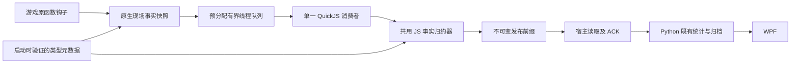

# PC 原生现场采集与单消费者

## 依据与验收范围

2026-11-26 的第13回合冻结记录显示，HP setter 约12607次/秒；严重窗口 FPS 中位数为1。
抽样进入回调锁内均值19.38微秒，退出32.92微秒；后者大部分在 JavaScript 内。
实际管道写入约0.206毫秒/秒，不能用批量发送解决这段同步工作。
这些数字来自改造前计时包，抽样墙钟不能当作精确 CPU 百分比，也不代表全部掉帧原因。
证据解释见[性能计时](performance-timings.md)。

观察器恢复修复后的另一盘（head `2b7a7c1`，run `c7e5537c171d455f95d5b864b40ada23`）
进一步区分了调用数量与处理分支。以下均为该同步版本的实机测量，退出耗时是抽样锁内均值：

| 同盘窗口 | HP setter/秒 | 退出锁内微秒/次 | FPS 中位数 |
| --- | ---: | ---: | ---: |
| 第13回合防御严重段 | 15431 | 21.52 | 1 |
| 同回合防御恢复段 | 21996 | 1.11 | 58 |
| 第13回合协防 | 23571 | 3.24 | 51.5 |
| 第14回合 Boss | 24067 | 9.59 | 1 |

协防与防御倍速不同，不作为冻结设置的因果实验。严重段的 health/stale 事件为0，
后段高 FPS 时反而发生短时过期；不能用过期次数代替掉帧证据。
5秒细窗估计最高约30390次 setter/秒，作为至少60000条进入/退出事实每秒的压力预算。
8192个记录槽只能覆盖约135毫秒此平均负载；字节预算还须独立核算。
对照要求包括300–500毫秒消费者停顿，不能以低频 ABI 调用代替压力验收。

同进程、同版本的下一盘（北京时间20:56–21:33）提供了另外一组自然对照：
第12、13回合干员 CID 与重复数量相同，HP setter 分别约12259、20283次/秒，
进入锁内均值15.78、16.14微秒，退出为1.45、10.31微秒；FPS 中位数47与2。
第13回合宿主重装士兵的6273条归并回血记录携带41775个原始回血 tick，说明已有归并
不能省掉归并之前的同步处理。第7回合宿主士兵回血期间也有4秒个位数 FPS。
新盘不同种类 Boss 的中位数为50，7个协防段均为60；“Boss 阶段”或“存在回血”本身
都不足以解释严重掉帧。装备、敌人、倍速和机器其他负载没有全部冻结，不能视作单变量实验。
这些仍是旧同步 DLL 的测量，不是异步候选的实机效果。

本机冻结证据分别存于 `runtime/async-evidence/recovery-baseline-c7e5537/receipt.json`
与 `runtime/async-evidence/natural-control-2056-prefix/receipt.json`；回执逐项记录原路径、
完整行前缀长度及 SHA-256。FPS 按真实 UTC 秒窗与进程出生身份对齐，原生累计值按
同线程/单元及 QPC 作差。抽样均值、锁内包含关系和累计峰值的限制继续适用。

本文记录当前集成的所有权与门禁。生产钩子合同完整、全链验证和私包清单完成前，
`complete:false` 必须拒绝安装；自有进程 ABI 测试不能替代完整 HP 路径或游戏 FPS 验收。

## 唯一调用链



原生层只复制字段合同要求的参数、现场值、对象身份、调用关系、时钟与作用域证据。
玩家归属、嵌套结算、回血归并、技能和生命周期仍由同一份 JS 事实归约器处理。
Python 仍负责统计与历史，WPF 仍只消费展示状态。Android/Frida 使用既有适配器进入共用归约器。

游戏回调不进入 QuickJS，不等待消费者，不经过宿主 mailbox，不做 JSON、日志或 IPC。
原函数仍保留完整 Windows x64 参数和返回值 ABI；观察器只复制声明的参数槽。
现场不能把裸对象指针排队后延迟重读。对象地址只是持有字节的标签，不是读取授权。

## 元数据与冷启动

`cold_plan.js` 在安装钩子前，沿实际字段类型验证闭合泛型，包括不同实例的
`ListDict`、`List`、`KeyValuePair`、字典 Entry 和数组；同名泛型不会合并为一个布局。
冻结的类名、命名空间、父类及已验证类型信息只用于类型判断。
对象当时的类型指针、五个战局根、静态单例槽、状态、名单、UID、字符串内容和时钟仍由现场取证。

冷对象图使用有界布局树复制当前名单及生命周期初态，不从上回合缓存改写出新回合的第0帧。
普通战局根与 AutoChess 子图分别持有，普通关不会因为没有 AutoChess manager 而产生虚假失败。
冷图仅在请求候选时采集，原生 claim 防止后台落后时每次 HP 回调都重复走大图。
第0帧的状态/回合边界主动取证，不等宿主轮询。单个棋子或单位的实际不可读按原有局部
try/catch 保留 unknown，独立成功成员仍可使用；身份、名单槽位或任何守卫变化不降格成局部成功。

所有队列、调用栈、图遍历和持有载荷都有上限。达到上限显式报告缺口；
不覆盖未消费记录，不阻塞原函数，不在缺口后继续确认不存在的完整前缀。

## 水位与状态转换

| 水位 | 含义 | 不能推出的事实 |
| --- | --- | --- |
| reserved | 已分配原始事实 ticket | 记录已经写完或可被读取 |
| processed | 消费者已按连续 ticket 归约 | 所有嵌套调用都已闭合 |
| closed | 实际 leave 现场存在完整闭合点 | 后续任意新作用域都可用此点代替 |
| published | 闭合点的身份、时钟与共享归约结果已持有 | 宿主已读或已提交 |
| served | 指定 token 的真实连续读取已返回 | 未返回的后段事件可被 ACK |
| acknowledged | 宿主确认已接受的连续事件序号 | 后续缺口可被补零 |

原始 ticket 与归约事件序号使用不同单位。64位 ticket 不经 JavaScript 浮点数转换。
同一事件序号可以有不同的独立时钟标记，因此宿主必须按 publication token 选择读取。
旧 token 返回自己持有的上下文；过期 token 明确重试，不静默改用最新上下文。

发布不调用会推进读取水位的旧 `readEvents`。只有真实读取成功才授权共享归约器的 ACK，
非空分页不能跳过尚未返回的前缀。中途连接的空 baseline 使用显式参数，仍由宿主验证原有基线证据。
迟到诊断绑定到下一个尚未发布的事件，不改变旧 token 的内容。

正常 mark 请求新的现场发布点，以继续满足“前 mark → 独立采样 → 后 mark”的既有屏障。
读取历史前缀无需等待当前游戏完全安静。最终 Destroy 的已验证闭合端点另行固定：
只有完整终局 DTO、序号、时钟、作用域与原生绑定一致，才标记 `terminal_verified`。
游戏线程不为归档同步等待后台。

## 验证入口

- `tests/native_capture_queue_test.cpp`：有界队列、半发布、回绕、满队列和跨线程拥有权。
- `tests/native_capture_owned.cpp`：字段、字符串、数组、冷图、现场变动和持有后原存储被污染。
- `tests/native_pc_owned_replay_fixture.js`：禁止现场迟读、错误角色、检查点、缺失字段和跨点复用。
- `tests/native_pc_publication_journal_fixture.js`：发布/读取/ACK 分离、跳读、token、容量与终局。
- `tests/native_pc_cold_metadata_fixture.js`：实际泛型闭包冻结，重放不做原生调用或现场元数据读取。
- `tests/native_async_engine_owned.py`：明确只操作自有进程，覆盖 ABI、慢消费者、停止恢复及捕获边界。

自有进程吞吐、队列年龄、回调现场成本和真实对局 FPS 分开报告。
现有嵌套普通/元素、首笔回血、死亡、协防、第0帧、空卫戍端点、最终水位和 observer 恢复回归继续有效。


## Packed 元数据的引用所有权

worker 只向 packed record 交一份独立复制的 header ArrayBuffer，回调不取得该缓冲区的可变引用。Record 与 Facts 共用私有 DataView，Facts 不引用 Record：

```text
Record ──→ Facts ──→ 私有 DataView ──→ copied header ArrayBuffer
   └───────────────────↑
                       └──→ 延迟、冻结的 parents 数组及成员
```

DataView 的私有 parents 缓存只保存字符串 ID 和 checkpoint，不保存 Record、Facts 或原生读取租约。未保留 Record/Facts 时可由引用计数直接释放，不必等待循环 GC；只保留 Facts 时，Record 也可释放，而已复制的元数据仍可跨后续 record/lease 安全读取。现场字段仍只能在当前 native owned-view lease 内读取，这份元数据不延长任何现场读取权限。
