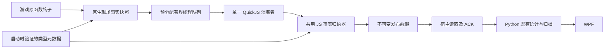

# PC 原生现场采集与单消费者

各伤害/公式钩子的按需字段合同、普通边界与发布/冷取证的区别，以及最新离线测量见
[采集需求与字段裁剪](native-capture-demand.md)。本文件的历史实机数字不替代该候选验收。

## 依据与验收范围

2026-11-26 的第13回合冻结记录显示，HP setter 约12607次/秒；严重窗口 FPS 中位数为1。
抽样进入回调锁内均值19.38微秒，退出32.92微秒；后者大部分在 JavaScript 内。
实际管道写入约0.206毫秒/秒，不能用批量发送解决这段同步工作。
这些数字来自改造前计时包，抽样墙钟不能当作精确 CPU 百分比，也不代表全部掉帧原因。
证据解释见[性能计时](performance-timings.md)。

观察器恢复修复后的另一盘（head `2b7a7c1`，run `c7e5537c171d455f95d5b864b40ada23`）
进一步区分了调用数量与处理分支。以下均为该同步版本的实机测量，退出耗时是抽样锁内均值：

| 同盘窗口 | HP setter/秒 | 退出锁内微秒/次 | FPS 中位数 |
| --- | ---: | ---: | ---: |
| 第13回合防御严重段 | 15431 | 21.52 | 1 |
| 同回合防御恢复段 | 21996 | 1.11 | 58 |
| 第13回合协防 | 23571 | 3.24 | 51.5 |
| 第14回合 Boss | 24067 | 9.59 | 1 |

协防与防御倍速不同，不作为冻结设置的因果实验。严重段的 health/stale 事件为0，
后段高 FPS 时反而发生短时过期；不能用过期次数代替掉帧证据。
5秒细窗估计最高约30390次 setter/秒，作为至少60000条进入/退出事实每秒的压力预算。
8192个记录槽只能覆盖约135毫秒此平均负载；字节预算还须独立核算。
对照要求包括300–500毫秒消费者停顿，不能以低频 ABI 调用代替压力验收。

同进程、同版本的下一盘（北京时间20:56–21:33）提供了另外一组自然对照：
第12、13回合干员 CID 与重复数量相同，HP setter 分别约12259、20283次/秒，
进入锁内均值15.78、16.14微秒，退出为1.45、10.31微秒；FPS 中位数47与2。
第13回合宿主重装士兵的6273条归并回血记录携带41775个原始回血 tick，说明已有归并
不能省掉归并之前的同步处理。第7回合宿主士兵回血期间也有4秒个位数 FPS。
新盘不同种类 Boss 的中位数为50，7个协防段均为60；“Boss 阶段”或“存在回血”本身
都不足以解释严重掉帧。装备、敌人、倍速和机器其他负载没有全部冻结，不能视作单变量实验。
这些仍是旧同步 DLL 的测量，不是异步候选的实机效果。

本机冻结证据分别存于 `runtime/async-evidence/recovery-baseline-c7e5537/receipt.json`
与 `runtime/async-evidence/natural-control-2056-prefix/receipt.json`；回执逐项记录原路径、
完整行前缀长度及 SHA-256。FPS 按真实 UTC 秒窗与进程出生身份对齐，原生累计值按
同线程/单元及 QPC 作差。抽样均值、锁内包含关系和累计峰值的限制继续适用。

本文记录当前集成的所有权与门禁。生产钩子合同完整、全链验证和私包清单完成前，
`complete:false` 必须拒绝安装；自有进程 ABI 测试不能替代完整 HP 路径或游戏 FPS 验收。

## 唯一调用链



原生层只复制字段合同要求的参数、现场值、对象身份、调用关系、时钟与作用域证据。
玩家归属、嵌套结算、技能和生命周期仍由同一份 JS 事实归约器处理。
产品只生产轻量敌方 HP 事实；全量回血归并与叶子压缩仅在显式研究装配中使用。
Python 仍负责统计与历史，WPF 仍只消费展示状态。Android/Frida 使用既有适配器进入共用归约器。

游戏回调不进入 QuickJS，不等待消费者，不经过宿主 mailbox，不做 JSON、日志或 IPC。
原函数仍保留完整 Windows x64 参数和返回值 ABI；观察器只复制声明的参数槽。
现场不能把裸对象指针排队后延迟重读。对象地址只是持有字节的标签，不是读取授权。

HP 早过滤只接受设置期已证明的精确非敌类型和同一现场成功读取的非 `trap_` ID；
未知类型、召唤/陷阱和读取失败继续完整采集。普通 setter 的无变化分支仍保留调用、
独立时钟与世代，嵌套 MaxHP dirty 会阻止省读。即使本次 HP 无业务写入，待处理的采样
请求仍可在其真实退出点单独捕获时钟与绑定发布证据，避免静默期所有候选都被过滤。

跨线程还须区分 ticket 分配顺序与字段实际读取顺序。原生在保留 ticket 前后验证活动跨度，
将混合现场显式标为 `capture_concurrent`；同线程嵌套不因此失效。原始参数、拓扑与字节
仍保留，后台仅将其中原本可读的 Game 字段降为 `changed_guard`，交给共用归约器的既有
不确定路径处理；缺字段、错误角色和越界仍是结构错误。冻结元数据不受影响。
`capture_uncertain_records` 按线程出生身份与 lane 世代记录，不能用未知现场生成精确归属。

## 元数据与冷启动

`cold_plan.js` 在安装钩子前，沿实际字段类型验证闭合泛型，包括不同实例的
`ListDict`、`List`、`KeyValuePair`、字典 Entry 和数组；同名泛型不会合并为一个布局。
冻结的类名、命名空间、父类及已验证类型信息只用于类型判断。
对象当时的类型指针、五个战局根、静态单例槽、状态、名单、UID、字符串内容和时钟仍由现场取证。

父类关系由这份元数据闭包统一拥有：安装期必须沿封存的父指针到 NULL 或已验证终点，
拒绝环、缺点、非法地址及节点/关系预算超限，成功后才原子发布完整 lineage 和祖先索引。
回放的 assignable、来源 UID、活体名单和 presence 共同查询此证明；未知类不能被缓存结果
或精确地址相等绕过，也不再把前10层未匹配当作否定结论。Android/Frida 的共用消费者同样
仅在完整父链结束后缓存否定结果；读取失败、环和工作预算耗尽仍保留未知。

冷图的 Character 布局门禁使用同一证明导出的 `class_set` 正集合。安装时校验并排序，
现场只持有对象 klass 并二分匹配，不读取父链、不分配。非成员仅表示没有授权读取该布局，
仍保留现场 klass，由后台统一证明其已知或未知身份，不生成另一套来源归属规则。

2026-11-27 的定位包实机记录在 01:02:22 报原因16，证明旧十层检查未结束，
日志未保留实际类名，不能据此判定现场是合法长链或异常父链。真实 prepare→16层外来
Character→`SetHpInternal` 的自有内存夹具中，旧实现重现同一 ancestry limit，修复后通过且无
回放现场读取；类环、缺点和未知类另有拒收回归。此证据仍不代替修复包的实机验收。

冷对象图使用有界布局树复制当前名单及生命周期初态，不从上回合缓存改写出新回合的第0帧。
普通战局根与 AutoChess 子图分别持有，普通关不会因为没有 AutoChess manager 而产生虚假失败。
冷图仅在请求候选时采集，原生 claim 防止后台落后时每次 HP 回调都重复走大图。
第0帧的状态/回合边界主动取证，不等宿主轮询。单个棋子或单位的实际不可读按原有局部
try/catch 保留 unknown，独立成功成员仍可使用；身份、名单槽位或任何守卫变化不降格成局部成功。

所有队列、调用栈、图遍历和持有载荷都有上限。达到上限显式报告缺口；
不覆盖未消费记录，不阻塞原函数，不在缺口后继续确认不存在的完整前缀。

容量按实际字段合同核算。40个棋子及一个召唤物的自有内存场景中，真实计划的
HP 进入记录907字节、回血退出6208字节；每秒3万次 setter、暂停500毫秒的纯回血
极端组合约需106.7MB。产品使用16个2MiB私有环及4个32MiB共享溢出环，字节 arena
合计160MiB，单个热线程可用130MiB；元数据槽数分别为2048与32768。
这是容量预算，不是实机分支占比；还需验证消费者吞吐，不能用扩容代替处理速度修复。

## 水位与状态转换

采集状态分别归属明确的生命周期，不能互相代替：

- 线程槽：空闲 → 当前线程出生身份/世代 → 已终止且完全排空 → 可复用。
  同时超过16个生产线程明确失败；不能仅凭 TID 或空闲时间回收。
- 调用槽：进入 → 嵌套子调用 → 退出。每次进入清理本调用的 HP 标志；
  子调用的 MaxHP dirty 只传播给当前仍开放的祖先，不污染后来复用该槽的钩子。
- 作用域图：设置期验证布局 → 现场持有独立根/时钟/名单证据 → 后台验证并发布。
  旧图稳定失配后，同一请求最多再用一次真实冷采集；旧图数据不能改写成新作用域。
- 采样请求：等待候选 → 原生独占 claim → 已闭合发布或真实未就绪。
  claim、raw ticket、业务事件序号和发布 token 分开计数，任意一个都不能充当其它水位。
- 模式：设置偏好世代 → 调用入口固定世代 → 现场作用域固定世代 → 新作用域首次生效。
  未闭合调用保留自己的入口证据；图和模式历史仅在无活动调用且连续原始前缀已消费时退休。
- 观察器：健康 READY → 样本拒收/小局变化时仍保留健康输入；明确结构缺口则失败关闭。
  显式停止负责清理，进程内一次性原生输入不会被重试流程销毁后重建。

| 水位 | 含义 | 不能推出的事实 |
| --- | --- | --- |
| reserved | 已分配原始事实 ticket | 记录已经写完或可被读取 |
| processed | 消费者已按连续 ticket 归约 | 所有嵌套调用都已闭合 |
| closed | 实际 leave 现场存在完整闭合点 | 后续任意新作用域都可用此点代替 |
| published | 闭合点的身份、时钟与共享归约结果已持有 | 宿主已读或已提交 |
| served | 指定 token 的真实连续读取已返回 | 未返回的后段事件可被 ACK |
| acknowledged | 宿主确认已接受的连续事件序号 | 后续缺口可被补零 |

原始 ticket 与归约事件序号使用不同单位。64位 ticket 不经 JavaScript 浮点数转换。
同一事件序号可以有不同的独立时钟标记，因此宿主必须按 publication token 选择读取。
旧 token 返回自己持有的上下文；过期 token 明确重试，不静默改用最新上下文。

发布不调用会推进读取水位的旧 `readEvents`。只有真实读取成功才授权共享归约器的 ACK，
非空分页不能跳过尚未返回的前缀。中途连接的空 baseline 使用显式参数，仍由宿主验证原有基线证据。
迟到诊断绑定到下一个尚未发布的事件，不改变旧 token 的内容。

正常 mark 请求新的现场发布点，以继续满足“前 mark → 独立采样 → 后 mark”的既有屏障。
读取历史前缀无需等待当前游戏完全安静。最终 Destroy 的已验证闭合端点另行固定：
只有完整终局 DTO、序号、时钟、作用域与原生绑定一致，才标记 `terminal_verified`。
游戏线程不为归档同步等待后台。

## 2026-11-27 重构收口变更控制

本轮承接 `948137d` 的冷类型门禁、轻量采集和结算证据修复。没有改变伤害核实条件、
跨平台业务口径或终局证明。侧会话的架构审计是删除冗余路径的依据，不是这些路径已造成
实机掉帧或数据损坏的证明。

| 原有并行路径 | 当前唯一所有者与边界 |
| --- | --- |
| 未接入的 `applyHpLeafFacts` 与原生 leaf helper | 从产品 runtime、引擎 include 和构建清单移除；`tests/experiments` 显式装配保留原研究断言，不参与打包 |
| 轻量模式仍维护全量回血 coalescer | 产品不分配出生索引/run、不维护或 flush 空合并状态；出生、MaxHP、离场与结算仍经共享 HP owner |
| source queue 与 publication 各自保留事件、read/ACK | `ArkdpsEventStore` 唯一拥有规范化事件、context、字节预算、served/ACK 与释放；journal 持发布证书、发布边界和必要快照元数据 |
| 启动偏好和终局仍走未来回调 mark | 新能力通过 `configure_mode` 控制偏好，fresh/confirm/terminal 使用同一采样调度器；旧 provider 兼容只在能力边界内 |

规范化事件进入 store 时复制一次并递归冻结。publication 验证 canonical 对象身份，
不再复制事件留存；读取时才生成传输回复。事件 sequence、raw ticket、完整闭合前缀、
published token 和实际交付水位保持不同含义。journal 的 ACK 委托 source store 提交，
没有另一份 ACK 游标；提交前失败不释放，提交后回复丢失的重试按唯一游标幂等完成。
诊断 context 按事件序号单调追加，拒绝回退，确保 ACK 释放连续前缀。

源业务归约器仍唯一决定结算、归属、技能和生命周期；C++ 只拥有原始 lane、拓扑与
捕获/消费/闭合前缀，Python 拥有统计与归档。四者不是四套伤害账本。
Frida/MuMu 与 native 是同一 store 的互斥运输视图。四段产品 source 按 store、
AutoChess、adapter、runtime 装配，assembly v3 分别固定文件与源码哈希，缺文件拒绝启动。

terminal 调度保留 Destroy 的真实完成边界及可靠端点快速路径。普通 fresh 点不能冒充
终局；confirm 仍绑定原请求及 token，模式控制不能隐式触发发布。
新 provider 拒绝没有 sampling 的 mark，避免意外回到旧未来回调等待。
独立审查以手动改变内部 fence/raw 状态构造了旧 token 对抗负例；生产中 fence 只在
Destroy 成功发布的同一 worker 操作内建立，未证明该不变量破坏正常可达。因此 tuple
绑定属于防御加固，不作为实际故障根因。快速路径要求证书与当前 raw ticket、活动世代
和模式相符。原负例输出保存在 `runtime/terminal-certificate-review/repro.log`。

修改局限于 source 装配、事件保留、原生请求调度和研究隔离。回退须整体恢复对应源码及
DLL，不能只换 JS 或使两份存储同时写入。旧历史读取兼容不依赖旧实时 coalescer。
研究装配以明确插入点验证共享源码，插入点漂移直接失败，避免悄悄测试旧算法。

门禁包括单一 store 所有权、预算、canonical 身份、不可变回复、served/ACK 提交前后
故障、遗失回复重试、终局、来源装配哈希及 PC/MuMu 业务对照。独立审查补入 context
序号回退负例。最终版本的全量、实际 DLL、吞吐与打包回执保存在
`runtime/refactor-closeout`；这些离线结果均不代替首局和高负载实机验收。

终局实机故障修复后最终门禁：全量 Python/JS 回归 6513 passed、29 skipped；实际 DLL 的 direct
五场景、light 两场景及 cold 失败/恢复四次请求通过。真实引擎的冷类型门禁与完整 scope
采样通过，研究装配六组逐笔/批量输出一致。纯轻量负载结果如下（均暂停消费者 500ms）：

| 请求负载 | 完整 setter 数 | 实际供给/秒 | 追平耗时 | 缺口码 |
| --- | ---: | ---: | ---: | ---: |
| 30k/s，10秒 | 300000 | 29989 | 53.8ms | 0 |
| 45k/s，10秒 | 450000 | 44977 | 88.3ms | 0 |
| 30k/s，60秒 | 1800000 | 29997 | 57.5ms | 0 |

对应 `final-30k-10s`、`final-45k-10s`、`final-30k-60s` 回执固定编译输入、
执行 bundle、原始进入/退出计数及完整闭合/发布水位。纯负载没有混合伤害/Buff、真实
detour/IPC 或逐事实发布延迟 p99，不能替代这些条件与实机 FPS。初跑的装配缺 helper、
轻量夹具错误调用研究 flush 等失败日志同目录保留；修正的是夹具装配，没有放宽门禁。

## 验证入口

- `tests/native_capture_queue_test.cpp`：有界队列、半发布、回绕、满队列和跨线程拥有权。
- `tests/native_capture_owned.cpp`：字段、字符串、数组、冷图、现场变动和持有后原存储被污染。
- `tests/native_pc_owned_replay_fixture.js`：禁止现场迟读、错误角色、检查点、缺失字段和跨点复用。
- `tests/native_pc_publication_journal_fixture.js`：发布/读取/ACK 分离、跳读、token、容量与终局。
- `tests/native_pc_cold_metadata_fixture.js`：实际泛型闭包冻结，重放不做原生调用或现场元数据读取。
- `tests/native_async_engine_owned.py`：明确只操作自有进程，覆盖 ABI、慢消费者、停止恢复及捕获边界。

自有进程吞吐、队列年龄、回调现场成本和真实对局 FPS 分开报告。
现有嵌套普通/元素、首笔回血、死亡、协防、第0帧、空卫戍端点、最终水位和 observer 恢复回归继续有效。

### 948137d 实机终局回放中断

`runtime/refactor-closeout/live-948-incident.json` 固定实际捕获前1712行及 SHA-256。
北京时间 2026-11-27 18:39:07，hook33（按实际安装次序为 Destroy）leave、ticket4408040
触发 `native_replay_gap`、code6。故障前最后完整原始水位4408038，队列落后0；此故障
不是 queue_full。角色0、字段0、两次 structural 分类及内嵌 bridge 标量读取行号对应以下链：

Destroy callback 在 `body` 证据域运行，返回后桥恢复默认 `leave`；随后独立执行的
prefix 调用终局核验，核验在时钟见证返回后从 `leave` 读取 singleton。合同中的这些字节
属于 `body`，因此被正确拒收。旧夹具将 callback 与 prefix 一起包在 `body`，掩盖了
真实引擎边界。修复须在实际 Destroy 记录资格内绑定核验域，并把夹具的 prefix 移出
callback 域；普通记录、普通 checkpoint 或伪造记录不能借用该权限。

终局证书唯一来自真实 Destroy 完成点。普通 sampling checkpoint 不含终局 body，
遇到保留的终局状态返回未就绪；终局请求交付已验证、tuple 匹配的 Destroy token。
不以旧根缓存或普通对象布尔替代现场证明，不放宽旧 stage 替换等拒收条件。

`runtime/terminal-destroy-prefix/final-broken/receipt.json` 用同一 O2 引擎二进制与冻结的
旧 JS source 复现默认角色0/字段0、status9 和 `10.10` 缺口；`final-fixed/receipt.json`
记录释放/保留 singleton 的成功、Destroy 期间 stage 替换拒收、缺 body/singleton 的
结构拒收五个场景。原生 `request_on_worker` 获取真实 Destroy token 时不增加请求与
采样计数；终局读取和 ACK 门禁通过。该夹具操作的全是自有进程内存，不是实机验收。


## Packed 元数据的引用所有权

worker 只向 packed record 交一份独立复制的 header ArrayBuffer，回调不取得该缓冲区的可变引用。Record 与 Facts 共用私有 DataView，Facts 不引用 Record：

```text
Record ──→ Facts ──→ 私有 DataView ──→ copied header ArrayBuffer
   └───────────────────↑
                       └──→ 延迟、冻结的 parents 数组及成员
```

DataView 的私有 parents 缓存只保存字符串 ID 和 checkpoint，不保存 Record、Facts 或原生读取租约。未保留 Record/Facts 时可由引用计数直接释放，不必等待循环 GC；只保留 Facts 时，Record 也可释放，而已复制的元数据仍可跨后续 record/lease 安全读取。现场字段仍只能在当前 native owned-view lease 内读取，这份元数据不延长任何现场读取权限。


## 原生读取的地址表示

NativePointer 的值始终是完整 uint64 BigInt。只有原生 provider 明确声明 `__nativeOwnedNumericAddress === true` 时，bridge 才把 `[0, 2^53-1]` 内的地址参数转为 Number；宽地址保留 BigInt。该能力与五个函数一起在 Begin 固定并纳入 provider 缓存身份，旧 provider 不会收到 Number。

C++ 同时保留完整 uint64 BigInt 解析，并独立要求 Number 有限、为整数且处于安全整数范围；NaN、越界及小数地址仍触发结构错误和原生 poison。这里仅优化地址传参，不改变字段、指针值、现场捕获、归约或读取权限。


### 原生发布回执与宿主快照

worker完成闭合点发布时，只接收同一journal事务返回的有界内部回执
（native_publication fence与native_capture_scope_mode_epoch）。该选项由C++调用固定传入，
不接受宿主command选择。journal仍先完成完整输入校验与独立所有权复制，mark/read/terminal/ACK
保留原DTO和游标规则；常规JS publish调用仍返回完整mark副本。

这消除了每次发布返回完整mark的额外JSON复制，以及C++仅为读取几个fence字段而再次编码、
解析完整body。旧captured_prefix_publication内部C++声明/实现没有源码、测试或已定义extern-C ABI
调用者，随已不用的完整字符串缓存一并移除。此改动只减少发布成本，不证明生产HP回放已跟上
事件入队速度，也不以扩容、跳过事实或改变fresh-mark要求来掩盖积压。


OwnedReplayView的字段与segment索引仍保留原顺序语义（role/checkpoint/id与role/checkpoint/address/原index）。
初始化时仅将通过相同校验的排序键解码一次到worker固定scratch，比较器不再反复解码序列化结构。
增加327680字节worker驻留，无Game回调分配；不省略字段、guard、attempt范围或点位。
生产HP计划生成的owned Snapshot专项覆盖小entry、changed回血及hostclaim publication输入；
该索引微测只说明索引初始化成本，不能代替实际QuickJS共享HP回调与持续入队的吞吐验收。


worker的标量验证使用固定kind范围，不为每次读取创建范围数组；Point/Witness/Checkpoint
用三个局部值在finally中恢复精确角色，不创建暂存数组。这不改变角色/字段/检查点、错误分类、
原生独立poison或浮点NaN的原始含义。`native_async_scalar_validation_owned.py`可在已有DLL的自有
child中，使用真实owned lease与原生provider对照两个实际标量验证函数；它测量helper成本，
不包含完整scope/publication/生产HP吞吐，也不声明游戏FPS改善。


### 跨宿主mark截止时间的冷捕获重试

warm候选在worker回放时失败，可能已经晚于该请求的100ms截止时间。冷捕获需求因此保留为
尚未修复的请求世代下界，而非仅匹配失败请求的相等ID；后续N+1/N+2请求仍会采集真正的
cold roots/body，不会因为换了宿主请求号就再次借用已失效的warm图。

清除需求必须发生在已验证的closed publication之后，并同时满足当前fresh raw ticket门槛、
scope/mode与当前配置一致且请求号不早于未修复世代。失败、旧成功或错误mode不能清除；
每请求最多两次native claim保持不变，无请求时不会由此触发逐HP冷捕获。该状态机不修改
事件序号、ACK、frame0事实、终局证据或读数归约。

`native_async_cold_deadline_owned.py`用真实DLL自有child，故意让首个warm候选越过截止时间，
再拒绝一次实际cold候选，要求两个后续请求都捕获cold proof，成功修复后下一次恢复warm。
它是请求世代/owned读取的验收，不是完整游戏关卡或吞吐替代。


### 缺少通知回调时的结算证据

伤害仍只有 shared runtime 的 `verifiedTargetSettlement → settleDamage` 一个验证与归约入口。
同一次 ApplyModifier 内若没有 Unit/Output 通知，但实际捕获到唯一一次 HP setter 的完整进入/退出，
可将这对独立证据交给原验证器。来源/目标 UID 与 class、作用域、时钟、开闭 HP、实际 signed delta、
数值盾和 overkill 一致性仍由原验证器核对；nominal amount 不能替代缺失的 HP。

原始 Apply 调用栈和 HP 写入尝试独立记账。HP setter 的嵌套早返也必须先增加尝试数，
否则同指针重入、临时 UID 变化后恢复会错误地看起来只有一个 writer。外来/未知来源的嵌套调用、
跨线程干扰、MaxHP 变更、取消或失败 guard 仍不能获得这份证书。
证书不制造 Unit.OnTakeDamage checkpoint，也不注册普通伤害的嵌套通知补链。
`test_event_probe_hp_settlement.py` 以实际捕获 recipe 检验 Solo/多人消费及重复回放只入账一次；
HP record 不含生产计划中不存在的父 checkpoint，缺证负例必须保持 partial。

### 队列状态与验证边界

原始 ticket、业务事件 sequence、published prefix、served prefix 和 ACK 仍是不同水位。
队列满或结构缺口仍显式失败，不能覆盖未消费记录、提前 ACK 或把旧 scope 标成当前。
普通日志复用 mark 已附带的计数，健康状态最多每五秒一条，持续 pending 两秒后最多每秒一条，
恢复记录只发一次；它不启用 callback timing、不额外请求、不进入统计事件流。

持续消费能力必须用实际共享 HP 回调和捕获形状验证。128-byte ABI 夹具、索引/标量微测和
字节容量证明各自只能验证其边界，不能代替完整 scope/publication、真实 FIFO 和暂停后追赶验收，
也不能代替实机 FPS。实验性的指针表示或字符串 codec 未通过收益门槛时不并入生产候选。


### Raw program ownership

The independently registered HP ReadPlan experiment was removed after the
actual shared-source A/B showed negative performance. There is no production
plan-registration API, metadata/handle registry, tier execution endpoint or
registration seal. HP retains the canonical source pointer-read path.

The raw executor remains owned by compiled CaptureGraph programs. Their packet
ABI and all lease, role, checkpoint, unique-field, overlap, guard and failure
rules remain unchanged. Programs use the fixed mask one; this internal packet
field is retained for compatibility, not a second tier API.


### Captured graph raw batches

`__arkdpsOwnedGraphReadBatch(kind, graph, chunkIndex)` pins the native provider
at ReplayBegin. Engine binds the exact retained header.configuration_id plus
scope/publication revision and entry mode. JS cannot select another config.
Native ABI: (kind, revision, graphModeEpoch, chunkIndex).

Programs derive once from the compiled CaptureGraph after role/ID interning,
retain flattened field order and split into 32-slot chunks. They share the
same raw executor and AB ABI. Each field requires the original unique
role/checkpoint witness and expected remapped ID before independently reading
all pointer links and final bytes through OwnedReplayView. Planned guard error
priority remains unchanged; genuine structural failures poison the replay.

JS still performs every canonical expected-value, clock, class, phase, round
and ownership comparison. Programs retire with CaptureGraph, not a parallel
revision registry. Game callbacks gain no VM calls, locks, waits or allocations.
The optimization supports absolute-root bytes 1..128 and UTF16 up to 200 units.
Other legal geometry keeps the original capture contract and is statically
selected for strict scalar reading; missing old-provider API does the same.
Present-helper execution errors never fall back. Offline semantic PASS does
not establish sustained production throughput or game FPS improvement.


### Fixed graph comparisons and dynamic projections

Graph fields can declare `projection: true` for values that remain interpreted
by the shared JS owner, or `projection: false` with a fixed comparison:
`{version:1, words:[{offset,kind,value}], utf16?:[uint16,...]}`. Word kinds are
u8, u32 raw bits, or u64_number (the existing Number(U64) interpretation).
Pointers use two u32 words; UTF16 compares exact length/code units, including
NUL and unpaired surrogates. A dynamic field may omit comparison. Explicit
comparison:null or unsupported geometry selects the original strict reader
before execution; malformed supported comparison declarations are rejected.

The same compiled CaptureGraph owns the derived comparison program. The same
raw executor checks each unique role/checkpoint, expected field ID, pointer
link and final range. Native code evaluates only these fixed raw predicates;
it does not calculate HP, healing, ownership, collection mode or scope state.
Static mismatch is changed_guard, not a fabricated value. Structural defects
still independently poison replay, including a later defect following an
earlier planned mismatch.

`__arkdpsOwnedGraphCheck(kind, graph)` returns a frozen branded proof only after
one native call verifies the entire graph. The AB contains only up to 32 dynamic
slots; an all-static publication has zero slots. The proof is tied to the same
replay lease, kind and graph object, and source checks it using
`__arkdpsVerifiedGraphProof(proof,kind,graph)` before skipping static comparison.
`proof.slot(originalIndex)` rejects static fields and later records. Dynamic
fields retain the shared JS canonical clock/state/phase/class interpretation.
Failure-only native field index maps back to the fixed role/current checkpoint;
no addresses or mutable facts are added to diagnostics. Existing graph raw-batch paths keep their prior contracts.


### HP raw primitive observations

Each actual HP capture field may declare
`observation:{name:field.name,values:[{kind,offset},...]}`. Kinds are u8, u32,
u64, signed i64 and exact UTF16. The compiled hook validates every projection
inside its original field and derives the per-phase program after role interning.
There is no separately registered read plan, tier registry or second SDK layout.

`__arkdpsOwnedHpObservation(contract,receiver)` acquires one flat immutable
primitive packet through the pinned native provider. The native binding uses
this record's compiled hook, original arg0, phase, checkpoint and captured mode;
the contract's installation mode is not a new-record identity. The array header
is version/count/phase/checkpoint/mode, followed by each descriptor's status and
raw values. Missing values are undefined, never zero. UTF16 is mechanically
encoded unit-by-unit as CESU8 into the pinned QuickJS string constructor; empty,
NUL, non-ASCII, isolated surrogates and pairs retain their original code units.

The exact same OwnedReplayView reader supplies graph and HP observations. Body
reads stay auto and can use independently successful overlapping evidence even
when a nominal primary field is absent or failed; failed prefixes lend no facts.
Clocks require the original unique point and expected field ID. The separate
trap eight-byte read remains a body-auto observation at its original branch.

HP prefetch records every read outcome locally, including structural outcomes;
it does not commit errors from unused facts. This deliberately differs from the
already explicit whole-graph NativeCheck operation. Only actual IO getter demand
calls ConsumeHpFailure(index), which selects the saved native status from the
same current lease and independently poisons structural errors. JS cannot supply
or downgrade the error code. Existing malformed view initialization still rejects
immediately. A count-zero branch never demands attribute words. Existing native
missing-root attributes remain truthful unknown and follow the canonical catch;
failed copied links cannot become a normal null witness.

The IO object has a private state and shared prototype methods, not per-edge
method closures or a replay-to-IO reference cycle. All values and metadata are
lease-bound; receiver values are rechecked, not inferred from object identity.
The source owns Q32 conversion, clock/range/UID checks, XOR, scope and eligibility,
HP state transitions and statistics. Ordinary pointer IO uses that same source
state reducer. No raw edge, parent topology, first heal, epoch or ACK is skipped.


### Sealed native provider ownership

Native installation publishes a null-prototype `__nativeOwnedProvider` data
bundle containing version one, numeric-address capability and the same native
function references as the legacy globals. Every bundle property and the global
bundle property is non-writable and non-configurable; the bundle is not
extensible. Legacy globals remain available for compatibility, but replacing
them cannot redirect the sealed owner.

ReplayBegin first validates all own descriptors, the required API set and
optional paired capabilities, then retains that immutable function owner.
Subsequent records avoid rescanning mutable globals. Record version/shape,
checkpoint and decimal ticket remain checked for each item. Legacy dispatch
checks the native lease and status at Begin/End. Controlled batches consolidate
those native checks into their independently validated native finish before
advancing processed/closed; the private permit cannot be created by a callback.
No live data or record facts are cached by this optimization. An absent bundle follows the original
global-by-global provider pin path.

The internal C++ install argument `sealed=false` exists only for a self-owned
harness counterfactual using the exact same functions in one executable.
Production calls the default true and exposes no host/product switch. Bundle
A/B must keep raw HP enabled in both arms and assert equal actual observation
counts. A raw-provider disabled test uses an explicitly labelled high-level
benchmark stub; deleting old globals cannot disable a sealed capability.

### 当前实施清单：事实直达、批量派发与作用域处理

2026-11-27 按用户认可的方向调整，承接本分支实际实现，不回退到咨询案的旧源码。
本次清单更新以 `4919cfb` 为代码基线，B 的实际功能回执另固定在 `4f33715`；
C 的受控原生完成校验、D 的精确认领及当前 item 的关闭时钟复用已集成。
以下“完成”只说明对应离线边界，
不代表持续吞吐或游戏 FPS 已验收。

| 阶段 | 状态 | 已有实现及实际剩余工作 |
| --- | --- | --- |
| A：事实合同与唯一业务所有者 | HP 边界已完成，继续做整体验收 | 所有端共用 `applyHpEntry/Leave`；原生从同一 CompiledPlan/OwnedReplayView 提供原始值，符号、Q32、XOR、身份、生命周期及结算仍由共享 JS 解释。无权威 C++ 业务副本。 |
| B：无预合并事实直达 | 已接入，功能通过，吞吐未达标 | 普通单层 HP 使用原生签发的原始 packet，调用同一 `applyHpEntry/Leave`，不创建 Arguments Proxy；嵌套、发布等保完整原路径。实际 DLL 覆盖父调用、发布回退、错根/错阶段和普通构造 IO 拒收。没有删掉任何原始 E/L。 |
| C：有界批量跨界 | 功能及真实引擎小负载通过，吞吐仍未达标 | 每批至多 32 edges、原 2ms 协作预算；单条/批量共用 prepare/finalize。每项独立租约，公开 record 按需复制，barrier 保留原字节和 ticket。完成数严格等于签发数及返回数，故障不确认尾部。受控 finish 独立核验租约/状态/健康，不能靠 JS 布尔值确认。 |
| D：后台 scope 重复工作 | 精确 native packet 认领已接入，继续量化 | 同一 GraphCheck 保全部字段/guard/predicate。format2 只认当前 ctx/ticket/config/program/revision/mode/checkpoint 下实际发行的同一 JSValue；布局完整字符串另核原 index、bytes 和 codecs。通过后省重复 JS 类型检查，不省底层验证或源 canonical 解释。旧 helper 保原严路径，执行失败不回退。 |
| E：叶子配对、无变化压实、回血预合并 | 暂缓，未启用 | 先完成无预合并的直达与批量版本。不得丢无变化 HP：finishModifierHpWriter 必须先于 unchanged 返回。每项压缩须独立开关与关闭版对照；不能证明等价的区间保持逐笔。 |
| 游戏线程 guard 差分扫描、多 VM | 暂缓 | 不在游戏线程额外扫描 64/785 个 fixture 字段；不以布局、同帧或没有通知代替现场证据；不增加并行权威状态机。 |
| 真实 DLL 与私有测试包 | 在做，未交付 | 原始 provider/模式绑定的新自有进程夹具已准备；完整引擎验收和压力验收后再打包。实机结果独立登记。 |

主要判据和现有回执：

- 原 pointer provider 重构前后，PC/MuMu、raw/compact 共 40 个场景的完整 JSON
  与状态逐字段相等，见 `runtime/production-hp-throughput/provider-parity/receipt/`。
  已知结算缺证的修正另有独立正负预期，不以复刻旧错误为目标。
- `runtime/production-hp-throughput/raw-attrs-golden/` 用相同真实 owned record
  比较缺 MaxHP 链的事件及 ReplaySummary；missing_root 仍是未知，未借失败前缀补 NULL。
- `runtime/hp-provider-profile/` 是实际 raw provider 的 1/128 inclusive 函数采样，
  每组 5000 setters 对应 10000 次实际 observation。scope 约 77.7us/调用，
  observation 工厂约 9.8us，CPP observation 约 3.24us/edge；这些包含关系不能相加。
  它定位成本，不是无插桩吞吐或 FPS。
- `runtime/production-hp-throughput/raw-observation-pair/` 的单组实际消费仍约
  5301 heal setters/s，控制约 5025/s，输入基线有约 20% 漂移；未证明稳定收益，
  更未通过 30000/s。该回执绑定当时 dirty native 文件 SHA，不冒称后续 sealed owner 的效果。
- 分段计时显示旧 ReplayDispatch 外围有分散固定成本；约 33us/setter 只是当时
  特定实现的插桩测量，不是理论下界。当前阻塞是完整消费成本，不是等待更多实机日志。
- `runtime/direct-hp-b-validation/` 固定 `4f33715` 的同 binary ABBA 对照。
  2000 次 setter、完整作用域、真实发布图；两轮回血 ordinary 为 5736/5843 次每秒，
  direct 为 5886/6191。每轮 direct 进入 2000、退出 1998、签发/认领 3998，
  发布回退 2、Arguments Proxy 0。直达已实际启用，但不构成 30000/s 验收。
- `tests/production_hp_actual_engine.cpp` 已接真实引擎内核；旧 isolated FIFO
  仍走普通 callback，不能拿它证明新批量版本。当前预填充小样本的完整事件 JSON、
  HP/MaxHP、未知状态、读取数/字节数及闭合/发布水位均相等，但约 6.5k/s 仍未达标。
  实际冻结的 publication 图为 1604 fields / 802 guard pairs，不能删字段凑旧 785 口径。
- `runtime/graph-typed-adoption/` 的同 binary 源对照确认实际认领 5005 次；
  两对性能差异为约 +2.1%/+20.7%，波动较大，不能仅凭均值宣布收益通过。
- `runtime/qjs-immutable-numeric/` 与 `runtime/binary-view-validation/` 是停止采用的
  实验。数组确会转普通属性表，但替代容器只省约 2.6–2.8us/packet；二进制 view
  没有显示收益。它们的生产实现未合入，不能列成已解决队列耗尽。
- 关闭时钟复用只在 changed HP 确实要 stamp scope 前登记；entry/unchanged 不登记。
  原 clock_close 已持有完整 12B，额外 i64 投影不增加 Game read，并额外核对 opening
  与 closing fixed 相等。样本与本次 Begin 的唯一身份绑定，跨 record 走原读取；
  scope 的新鲜双时钟、身份、阶段、回合和 guard 仍全部验证。

冻结验收口径：

1. 先完成无预合并版的事件顺序、逐笔结算/未知状态、身份、时钟、终局及 ACK 对照。
   原生快路径计数必须证明实际启用；普通对象或另一记录不能伪造证明。
2. 纯回血 30000 setter/s、10 秒、300000 setters；原始 E/L 和业务输出分别计数。
   未完成 10 秒或 code4 必须保留失败，不能用合并后事件数量替代输入量。
3. 500ms 消费暂停后持续追赶；候选目标 2.5 秒内追平、稳态发布延迟 p99<50ms，
   明确起止时钟与排除项。45k/s 余量需饱和供给或积压追赶另测，不能由 30k 限速实验推出。
4. 60 秒混合负载须冻结真实输入/调用类型与比例的来源；不能把专家示例比例标成实测。
   伤害型输入若超过 100000 业务事件，必须模拟真实 read/served/ACK；不放大或截断业务队列。
5. 无静默丢弃、无越界读取、无提前 ACK；原始、闭合、处理、发布、交付、ACK 水位独立。
   所有游戏回调继续不依赖消费者 VM；扩大 arena 或缓冲不能替代持续吞吐通过。
6. 离线与实机分开验收。私有包交付时列明尚未通过的压力/实机条件，不能用局部 PASS
   宣称游戏 FPS 已改善；数据过期和未核实命中继续按各自根因分类。

### 2026-11-27 事实包取值与真实并发反例

当前共享 JS HP IO 已替代 `deeb101` 的 C++ 逐字段 IO 实验；产品中不保留两套 HP 业务或取值类。
原生继续从同一 CompiledPlan/OwnedReplayView 生成不可变原始 packet，精确认领实际对象，
绑定配置、plan、ticket、nonce、phase、root、checkpoint、mode 与 scope/publication。
匹配布局后共享 JS IO 直接读原始整数，省逐字段 FFI；业务解释仍是 applyHpEntry/Leave。
原生 Begin/End 和重绑定会主动把实际 JS frame 的失效字段置为只读 false；
接收对象转换后再检查失效，拒收还会立即设置原生结构故障。
所有原 assert(poisoned) 负例保留；新增 Native End 早于 JS End、配置重绑、数组复制伪造用例。
旧能力缺失保原始完整检查；认领失败不能走成功回退。

同二进制 2000 setters 对照的完整业务事件 JSON 一致：回血约6399→7439/s，
unchanged约12868→13693/s，damage约5245→5574/s。这是单组小样本，不是持续目标通过。
`runtime/hp-typed-packet/engine/io-pair/receipt.json` 保存当时实际 binary/JS/input 的哈希。

此前 C++ IO 候选的真实并发夹具复用 pin_mode_entry、CaptureConfigurations、
capture_scope_point、CaptureLanes、prepare/finalize/drain 和完整生产 JS；不操作游戏。
每次先 active 再 pin config，同一 config 配对 E/L；完整 scope64/publication1604。
1k/s、1000 setters、500ms 暂停在约94ms追平且全部闭合发布。
30k/s、300000 setters 目标在25703个 setters 后 code4 失败，实际供给约29688/s。
失败见 `runtime/paced-real-engine/target-30k-10s/receipt.json`，不能标为10秒成功；
这是先前 C++ IO 候选，不能冒称当前 JS packet 候选已经跑过该持续目标。
每笔 p99 发布、60秒真实混合负载及游戏FPS仍未验收。

2026-11-27 方向调整：用户确认采用[敌方 HP 轻量采集合同](native-hp-lightweight-contract.md)，取消精确敌方累计回血与含回血可承受量，先按业务需求减少生产。叶子事实组与回血压缩暂缓，未接入产品。结算内全部相关写入、关键生命周期/MaxHP 事件、快照刷新和终局/read/ACK 水位继续保留；计划不采集与真实缺口分别处理，不通过扩大队列或隐藏错误冒充吞吐修复。

### 2026-11-27 主分支同步与无回调采样、游标所有权修复

先以 `dee6914` 合并当时最新 main `4c7ffb0`（包含其余 9 项提交），保留原生队列、共享 HP 入口和轻量合同，同时接入主线暂停/恢复采集。原生控制不重新安装一次性钩子；Frida 首次安装和恢复安装共用同一监听器入口。以下改动在这个合并点上进行，没有覆盖此前正确性修复。

实机 `bf0b40b` 记录及自有 DLL 复现共同定位了一个活性错误：mark 每次都等下一个业务回调产生发布。低事件密度或暂停时，即使 `reserved=processed=closed=published` 且 failure 为 0，也可能连续重试。宿主的 opening/sample/closing 又会再要求下一回调，因而在“暂停”“过期”“正常”间切换。证据冻结在 `runtime/fresh-publication-incident/`；捕获前 3934 行 SHA256 为 `59735ab49349b147e4955836fe90ac0cc691fb9ba2ab3a736fae9e5687c06cfd`。这是当前已证原因，不以渲染 FPS 或 retry 数替代采样可靠性。

| 状态及所有者 | 本次修复的转换与不变量 |
| --- | --- |
| 原生采样事务，单 worker | 显式 `sampling=fresh` 建立请求，未完成请求仅凭原请求身份跨宿主重试；请求还绑定模式世代。缺少重试身份就新建事务，跨模式复用拒收。`confirm` 绑定原 opening 的保留 token，再取当前独立证据，不能把旧 mark 改时间戳后当新样本。 |
| 现场检查点，现有 CompiledPlan/OwnedReplayView | 没有业务回调时，后台独立读取 clock、scope、publication/cold 字节，验证安静且完整闭合的前缀。真实活动、模式或时钟/guard 变化拒收并重试；结构缺项仍失败。 |
| 发布 journal，单一业务投影 | 检查点进入原 `capturedClosedRecordProjection`，没有第二套战局/归属状态。`kind=sampling_checkpoint` 用独立正序 serial；原始 ticket 和业务 sequence 可保持 0，不伪造 enter/leave。只有原生实际签发对象、有效租约及一次性品牌可发布。 |
| opening/closing，宿主一次采集 | Python 只确认本次 mark 的原始对象及同一 cursor lifetime。双方仍须通过原有帧、时间和作用域 barrier；确认不要求下一次业务 hook，也不取消独立采样。 |
| pending scope，旧观察器 | 更换观察器时先退休精确的旧 owner，记录 `pending_scope_observer_retired` 覆盖缺口；新 owner 建立自己的真实基线。旧前缀不由新 owner 读取或 ACK。暂时 observer=None 不是退休，仍允许原 owner 恢复。 |
| cursor lifetime，同一观察器 | 同一个 owner 真正重置仍报 StreamGap。失败日志仅保留阶段、存在性和固定原因，不输出 token/地址。 |
| UI 新鲜度，现有 DesktopState | 同帧的新鲜可靠采样可显示暂停；真实采样失败仍会过期。没有扩大超时、重新标记旧数据或隐藏提示。 |

采样计划是不可执行的 `sampling_checkpoint` profile：地址 0、无参数/entry roots、两次独立 12 字节时钟，强制 live scope/class ancestry/full native binding，冷路径有同根前后证据。普通钩子的 entry/leave 要求不变。终局投影还要原生 terminal fence 的当时现场证明，不能仅靠已有 JS 终局对象发布成功。raw、处理、闭合、发布、交付和 ACK 水位仍分开。

能力协商后产品显式使用新事务。未声明 sampling 的旧调用方继续原 callback admission/terminal 协议，宿主到达即设置请求，每次重试可认领新的冷候选。复核曾发现候选错误地让旧调用方沿用耗尽请求；失败回执保存在 `runtime/fresh-sampling/dll-gates/`，修复后的原门禁另存 `dll-gates-v2/`，没有放宽原断言。

游标截图所对应的旧普通日志没有完整失败阶段，不能声称已还原截图的唯一分支。已复现并修复的是“新 observer 比较旧 pending token”的确定性生产路径；同 owner 重置的独立负例继续拒收。新包正常日志的有限 `cursor_failure` 和 `native_async_capture.sampling` 能区分后续实际拒收原因；采样 retry_reason 是最近一次尝试，需同时看 request/completed_request，不能把已完成请求的历史原因当当前故障。

验收回执：

- `tests/test_native_sampling_acquisition.py`：请求重用、原始 opening/租约、配置改变及严格 raw0 合同；`tests/test_pending_scope_start.py`：新 owner、不向旧 owner ACK、None 恢复及真实 reset 拒收。
- `runtime/fresh-sampling/checkpoint-final/receipt.json`：真实 engine 事务、owned 字节、journal；无 hook/暂停/raw0、时钟变化、原生品牌/过期租约、跨模式请求、终局正反例及结构故障。
- `runtime/fresh-sampling/production-final/final/receipt.json`：完整共享投影 scope64/publication1604，无业务 hook 时新帧/同帧新 token；cold、时钟、模式、对象 guard 及错误计划负例。这一夹具直接调用共享 sampler，不冒充 IPC 事务；上项覆盖事务。
- `runtime/fresh-sampling/dll-gates-final/`：实际 DLL 的原 direct HP、轻量边界、冷请求跨期限门禁；`bounded-v2/`：原 20 项原生负例。
- 全量 pytest、压力及便携包的最终回执与交付包一起保留。离线通过不代表真实游戏 FPS 或所有实机 barrier 已通过；下一盘应检查低事件密度、暂停/恢复和防御/协防切换。

本轮全量离线回归 6414 passed / 29 skipped；最后补齐原生请求的模式绑定后，相关 195 项及原生事务/实际 DLL 门禁再通过。最终源码的轻量 30k/s、10 秒完成 300000 次 setter，500ms 暂停后约 78ms 追平、code0，回执 `runtime/fresh-sampling/pressure-final-30k-10s/receipt.json`。模式绑定补齐前的同一轻量路径另完成 60 秒/180 万次，约 71ms 追平，留在 `pressure-30k-60s/`，不混同版本。压力夹具未包含宿主新 sampler 事务流量，不据此声称已验证真实 mark 频率下延迟或实机表现。

变更控制：本次只扩展现有采样请求、CompiledPlan/OwnedReplayView、共享投影和观察器生命周期，不新建业务状态所有者。原生新增事实由其当时实际持有字节及租约负责；可选 `confirm_mark` 没有渗入其他平台的取证解释，未支持者仍走原接口。严格拒收条件由上述负例保护，没有以文案或阈值补偿。最先失败的边界分别是原生 checkpoint/采样事务、宿主原 opening 与 cursor owner；均可在自有内存/日志回放中复现。新增检查点是原发布机制的一种受控输入，不是另一套事件统计或治理层。仍未覆盖的边界是新候选实机成功率、真实混合持续负载和游戏 FPS。

### 928e496 首局失败：实机验收未通过及定位信息修复

用户于 2026-11-27 的首局报告 `native runtime mark failed; error_type=std::exception`。
此报告否定该候选的实机可用性验收；上一节的离线 PASS 不能替代它。
实际运行 head 为 `928e4967e2fff9912ae398a2c98b04e93067340c`，DLL SHA256
`ad59ecf184794b7a992d2a11ebd0d091b9a84cb65ae7678efb80da92fc3ddd34`，
PID 13948 / birth 134402455742041062。证据冻结在
`runtime/first-battle-928e496/evidence.json`；820 行捕获前缀 SHA256
`92dafc60c4b92092b6d9578a1bc09937023b1fa8bbf1716ff345845d434ed399`。

北京时间 17:33:13–17:36:39，大厅期间 raw/processed/closed/published 均为 0，
采样主要报 missing_root（Error 4），没有成功发布。17:36:40 首局开始，故障前
最后摘要为 raw=processed=closed164、published0、sampling serial112、request2/
completed0、lane failure0，最近原因 projection_not_ready；17:36:40.597806 的
mark 请求转为 RuntimeError。队列当时已消费，不能把本次异常归为队列耗尽。
后续宿主 fallback/sample 状态不是原生观察器恢复；它已 FAILED 且不能在进程内重建。

旧日志没有保存原始 C++ 抛出点。确定的诊断生产缺陷有两层：

1. 普通回调会带上 owned replay 缺项账，独立采样在 complete=false 时只丢出一句
   `sampling checkpoint violated owned boundary`，丢失 role、field、checkpoint 及原因码。
2. runtime 隐私过滤器又不认识新采样异常，最终只留下 `std::exception`。

本次改动修复上述诊断缺陷，**尚未修复或确认首局具体业务根因**。采样 End 前保留
原有 replay 引用，End 后仅生成既有的有限数值账，不延长内存租约。
`native_sampling_gap` 不虚构 hook ID/进入退出边界；`native_sampling_failure` 只携带
阶段、实际 LaneFault 和 JSON 异常编号。阶段 1–7 依次为现场取证、owned 绑定、
共享投影及 End、journal、回执编解码、证书、提交。server 和 Python/普通日志均
严格验证数值范围与格式，不回传任意异常文本、指针、token 或游戏字符串。
捕获失败、poison、read/ACK 及不可重启规则保持不变。

补充自有内存实验见 `runtime/review-cold-mode1/receipt.json`：无初始 scope/pub、
模式 1、state1→2、256KiB JS 栈、82 次真实 setter（raw164/sequence82）、普通
回调发布与独立采样交替均未复现 fatal。它们不能证明实机问题消失。
仍缺少真实 initialize 元数据、实际 worker 请求与首局交错的统一现场证据，不能
从泛化异常断言 JSON 错误、某个干员或放宽冷校验。

本次诊断门禁：`runtime/first-battle-928e496/checkpoint-diagnostics/receipt.json`
保留正常采样与 --gap/--receipt/--receipt-type 三个严格拒收正反例，确认拒收不推进
发布、token 或业务水位；`diagnostics-numeric-gate/receipt.json` 执行真实 server
过滤函数的 78 项有限格式/恶意字符串门禁；`diagnostic-regression.xml` 的相关
Python/JS 回归 300 passed。独立 review 的内存 mutation 放宽阶段范围后负例失败。
新包应明确标为定位包，普通日志即可给出具体阶段/缺项，不以这组 PASS 宣称业务根因
已解决，也不要求用户为了取证打完整大局或开启逐笔详细日志。

### 9c2bb39 复现后的冷根类型门禁根修

新实机定位包于北京时间 2026-11-27 18:00:24.084796 记录了
`native_sampling_gap`：stage3、LaneFault6、ticket224、role1、field20481、两条
原因分类 `10.10`。证据在 `runtime/first-battle-9c2bb39/evidence.json`；644 行
冻结前缀 SHA256 为 `a62698b03ecffa76b2dc1fdd4e744f494331490f748f548f32b145874a3d08e9`。
该 role/field 对应 `cold.root_open`。`10.10` 是 JS 的 native-owned-structural
分类，不能当成底层 `Error::ambiguous_read`；实机未记录当时具体 class 值。

自有实际 engine 复现找到确定的合同错位：冷树对 BattleController 做 exact-class
gate，类型不匹配时只保存 8 字节 class 证据并停止后续对象读取；共享
`terminalIdentity` 却先要求完整 24 字节，再判断 class。这会把一个本来可以正常
拒收的错误类型变为 `missing_plan_field`，poison 后整局观察器不可用。将自有
controller 的 class 换为另一个真实类型，得到与实机同型的 stage/field/分类，
独立读取 NativeOwnedStatus 确认底层为 9（missing_plan_field）。旧源码及失败
回执保存在 `runtime/review-cold-mode1/rootclass-receipt.json`，不能把合成 class
值反推为实机实际 class。

修复在同一个共享身份入口完成，PC/MuMu 业务校验没有分叉：

- captured replay 先读确实持有的 8 字节 class，错误类型立即拒收；只有匹配后
  才读取 24 字节块，并再次核对块内 class。真实缺项、冲突字节或伪造证明仍失败。
- raw 适配器保留原单次 24 字节块读取，以块内 class 验证，不增加前置 native
  读取。原性能门禁的 scope 58 次读取保持通过，没有调整读预算断言。
- 错误类型的描述只使用 setup 已有不可变类名缓存。logger/level/stats 的未知
  class 也严格拒收，不为了报出名字而读取 cold 合同之外的元数据。正确对象恢复
  后必须取得新的独立样本；错误类型不发布、不交付、不 ACK，也不销毁观察器。

这是修复已复现的取证/读取合同生产路径，未放宽 OwnedReplayView、冷根 exact
gate、时间/作用域、水位或终局条件。新的正式 actual-engine gate 对同一二进制
分别运行旧/新共享源码，覆盖 known/unknown/null controller、未知 logger/level/
stats、逐次恢复，以及类型正确但确实缺少 24 字节的严格负例；另用真实共享函数
覆盖 raw 单块与 captured 两阶段类不一致。回执随本次测试包保存。实机首局是否
已稳定仍需新候选自己的验收，不能由离线同型复现直接宣布。

最终回执为 `runtime/root-class-regression/broken-v2/receipt.json`（旧源码）、
`fixed-v2/receipt.json`（六类错误与六次恢复、真实缺项仍拒收），二者均使用
SHA256 `f3e004bcae99266dfe9aa795da0eba68e845e67d5dccd9cb938140de874d1d4e`
的同一 actual-engine 二进制。原九场景门禁另存 `original-nine-row/receipt.json`。
共享源码 SHA256 为 `d1ed6c7c572b561dcc06eff25c8ec9929942d998bb5757ba11fe687bc78ffa61`。
最终全量回归 `runtime/first-battle-9c2bb39/pytest-final-verified.xml` 为 6501 passed /
29 skipped；此前新增 raw 预读导致 58→60 次的失败回执保留，生产代码已恢复原预算，
没有放宽断言。本次仅改共享 JS 的读取门禁，沿用已验证的原生 DLL
`147c9c9359fb55299fafba6e4cb39901de2ea2cef63fe2bb94474f7e429bcdd4`。
